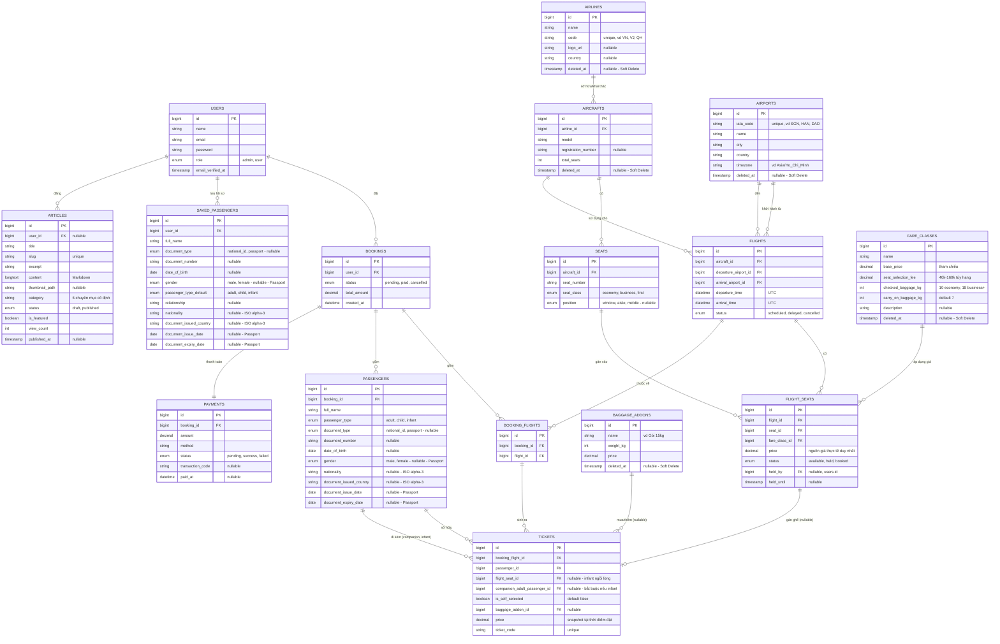

# Thiết kế Database - Website đặt vé máy bay (IDEA_3 - bản hợp nhất)

Hợp nhất từ IDEA_1 (đã chốt trước đó) + cấu trúc quan hệ tham khảo từ IDEA_2, đã sửa lỗi và bổ sung theo các yêu cầu mới (multi-airline, hạng vé, hành lý, chọn ghế trả phí, timezone, hồ sơ hành khách đã lưu).

Naming convention: tiếng Anh, đúng chuẩn Laravel/Eloquent.

## ERD (Mermaid)



## Lược đồ quan hệ (dạng text)

```
users(id, name, email, password, role, email_verified_at)

airlines(id, name, code, logo_url, country)

airports(id, iata_code, name, city, country, timezone)

aircrafts(id, airline_id FK->airlines, model, registration_number, total_seats)

seats(id, aircraft_id FK->aircrafts, seat_number, seat_class, position)
  UNIQUE(aircraft_id, seat_number)

fare_classes(id, name, base_price, seat_selection_fee,
             checked_baggage_kg, carry_on_baggage_kg, description)

flights(id, aircraft_id FK->aircrafts, departure_airport_id FK->airports,
        arrival_airport_id FK->airports, departure_time, arrival_time, status)
  CHECK departure_airport_id <> arrival_airport_id
  -- KHÔNG lưu airline_id trực tiếp, suy ra qua aircraft_id -> airlines (tránh transitive dependency)

flight_seats(id, flight_id FK->flights, seat_id FK->seats, fare_class_id FK->fare_classes,
             price, status ENUM[available|held|booked] DEFAULT available,
             held_by FK->users NULLABLE, held_until TIMESTAMP NULLABLE)
  UNIQUE(flight_id, seat_id)

bookings(id, user_id FK->users, status, total_amount, created_at)

booking_flights(id, booking_id FK->bookings, flight_id FK->flights)

passengers(id, booking_id FK->bookings, full_name,
           passenger_type ENUM[adult|child|infant],
           document_type ENUM[national_id|passport] NULLABLE,
           document_number NULLABLE, date_of_birth NULLABLE,
           gender ENUM[male|female] NULLABLE,
           nationality NULLABLE, document_issued_country NULLABLE, 
           document_issue_date NULLABLE, document_expiry_date NULLABLE)

tickets(id, booking_flight_id FK->booking_flights, passenger_id FK->passengers,
        flight_seat_id FK->flight_seats NULLABLE,
        companion_adult_passenger_id FK->passengers NULLABLE,
        is_self_selected BOOLEAN DEFAULT false,
        baggage_addon_id FK->baggage_addons NULLABLE,
        price, ticket_code UNIQUE)

payments(id, booking_id FK->bookings, amount, method, status,
         transaction_code NULLABLE, paid_at NULLABLE)

saved_passengers(id, user_id FK->users, full_name,
                  document_type ENUM[national_id|passport] NULLABLE,
                  document_number NULLABLE,
                  date_of_birth NULLABLE, gender ENUM[male|female] NULLABLE,
                  nationality NULLABLE,
                  document_issued_country NULLABLE, document_issue_date NULLABLE,
                  document_expiry_date NULLABLE,
                  passenger_type_default, relationship NULLABLE)

baggage_addons(id, name, weight_kg, price)
```

## Chi tiết các bảng (DDL - MySQL/MariaDB)

Kiểu dữ liệu và ràng buộc viết theo chuẩn MySQL, tương thích engine InnoDB (bắt buộc cho FK + transaction + `lockForUpdate()`).

### 1. users
Tài khoản đăng nhập, phân quyền qua `role` (Middleware). Các cột Breeze sinh tự động (`remember_token`...) không liệt kê lại.

```sql
CREATE TABLE users (
    id                  BIGINT UNSIGNED AUTO_INCREMENT PRIMARY KEY,
    name                VARCHAR(150)    NOT NULL,
    email               VARCHAR(150)    NOT NULL,
    password            VARCHAR(255)    NOT NULL,
    role                ENUM('admin','user') NOT NULL DEFAULT 'user',
    email_verified_at   TIMESTAMP       NULL,
    remember_token      VARCHAR(100)    NULL,
    created_at          TIMESTAMP       NULL,
    updated_at          TIMESTAMP       NULL,
    UNIQUE KEY uq_users_email (email)
) ENGINE=InnoDB;
```

### 2. airlines
```sql
CREATE TABLE airlines (
    id          BIGINT UNSIGNED AUTO_INCREMENT PRIMARY KEY,
    name        VARCHAR(150)    NOT NULL,
    code        VARCHAR(10)     NOT NULL,
    logo_url    VARCHAR(500)    NULL,
    country     VARCHAR(100)    NULL,
    deleted_at  TIMESTAMP       NULL, -- Soft Delete: độc lập, không cascade
    created_at  TIMESTAMP       NULL,
    updated_at  TIMESTAMP       NULL,
    UNIQUE KEY uq_airlines_code (code)
) ENGINE=InnoDB;
```

### 3. airports
```sql
CREATE TABLE airports (
    id          BIGINT UNSIGNED AUTO_INCREMENT PRIMARY KEY,
    iata_code   VARCHAR(10)     NOT NULL,
    name        VARCHAR(200)    NOT NULL,
    city        VARCHAR(100)    NOT NULL,
    country     VARCHAR(100)    NOT NULL,
    timezone    VARCHAR(50)     NOT NULL,   -- vd 'Asia/Ho_Chi_Minh'
    deleted_at  TIMESTAMP       NULL, -- Soft Delete: độc lập, không cascade
    created_at  TIMESTAMP       NULL,
    updated_at  TIMESTAMP       NULL,
    UNIQUE KEY uq_airports_iata (iata_code)
) ENGINE=InnoDB;
```

### 4. aircrafts
```sql
CREATE TABLE aircrafts (
    id                  BIGINT UNSIGNED AUTO_INCREMENT PRIMARY KEY,
    airline_id          BIGINT UNSIGNED NOT NULL,
    model               VARCHAR(100)    NOT NULL,   -- vd 'Airbus A321'
    registration_number VARCHAR(20)     NULL,
    total_seats         INT UNSIGNED    NOT NULL,
    deleted_at         TIMESTAMP       NULL, -- Soft Delete: độc lập, không cascade
    created_at          TIMESTAMP       NULL,
    updated_at          TIMESTAMP       NULL,
    CONSTRAINT fk_aircrafts_airline
        FOREIGN KEY (airline_id) REFERENCES airlines(id)
        ON DELETE RESTRICT ON UPDATE CASCADE
) ENGINE=InnoDB;
```

### 5. seats
Sơ đồ ghế vật lý cố định theo máy bay. `seat_class` là thuộc tính vật lý, khác `fare_classes` (thuộc tính thương mại).

```sql
CREATE TABLE seats (
    id              BIGINT UNSIGNED AUTO_INCREMENT PRIMARY KEY,
    aircraft_id     BIGINT UNSIGNED NOT NULL,
    seat_number     VARCHAR(10)     NOT NULL,   -- vd '12A'
    seat_class      ENUM('economy','business','first') NOT NULL,
    position        ENUM('window','aisle','middle') NULL,
    created_at      TIMESTAMP       NULL,
    updated_at      TIMESTAMP       NULL,
    CONSTRAINT fk_seats_aircraft
        FOREIGN KEY (aircraft_id) REFERENCES aircrafts(id)
        ON DELETE CASCADE ON UPDATE CASCADE,
    UNIQUE KEY uq_seats_aircraft_number (aircraft_id, seat_number)
) ENGINE=InnoDB;
```

### 6. fare_classes
Hạng vé, chứa giá tham chiếu, phí chọn ghế, định mức hành lý miễn phí.

```sql
CREATE TABLE fare_classes (
    id                      BIGINT UNSIGNED AUTO_INCREMENT PRIMARY KEY,
    name                    VARCHAR(50)     NOT NULL,   -- vd 'Economy', 'Business'
    base_price              DECIMAL(12,2)   NOT NULL,   -- giá tham chiếu, KHÔNG dùng tính tiền thật
    seat_selection_fee      DECIMAL(10,2)   NOT NULL DEFAULT 0, -- 40,000 - 160,000
    checked_baggage_kg      INT UNSIGNED    NOT NULL DEFAULT 0, -- 10 economy, 18 business+
    carry_on_baggage_kg     INT UNSIGNED    NOT NULL DEFAULT 7,
    description             VARCHAR(255)    NULL,
    deleted_at              TIMESTAMP       NULL, -- Soft Delete: độc lập, không cascade
    created_at              TIMESTAMP       NULL,
    updated_at              TIMESTAMP       NULL
) ENGINE=InnoDB;
```

### 7. flights
`departure_time`/`arrival_time` lưu UTC, hiển thị convert theo `airports.timezone` tương ứng.

```sql
CREATE TABLE flights (
    id                      BIGINT UNSIGNED AUTO_INCREMENT PRIMARY KEY,
    aircraft_id             BIGINT UNSIGNED NOT NULL,
    departure_airport_id    BIGINT UNSIGNED NOT NULL,
    arrival_airport_id      BIGINT UNSIGNED NOT NULL,
    departure_time          DATETIME        NOT NULL,  -- UTC
    arrival_time            DATETIME        NOT NULL,  -- UTC
    status                  ENUM('scheduled','delayed','cancelled') NOT NULL DEFAULT 'scheduled',
    created_at              TIMESTAMP       NULL,
    updated_at              TIMESTAMP       NULL,
    CONSTRAINT fk_flights_aircraft
        FOREIGN KEY (aircraft_id) REFERENCES aircrafts(id)
        ON DELETE RESTRICT ON UPDATE CASCADE,
    CONSTRAINT fk_flights_dep_airport
        FOREIGN KEY (departure_airport_id) REFERENCES airports(id)
        ON DELETE RESTRICT ON UPDATE CASCADE,
    CONSTRAINT fk_flights_arr_airport
        FOREIGN KEY (arrival_airport_id) REFERENCES airports(id)
        ON DELETE RESTRICT ON UPDATE CASCADE,
    CONSTRAINT ck_flights_diff_airport
        CHECK (departure_airport_id <> arrival_airport_id),
    INDEX idx_flights_departure_time (departure_time)
) ENGINE=InnoDB;
```
Lưu ý MariaDB 10.4.28: `CHECK` constraint được parse nhưng nên xác nhận enforce đúng khi test (một số bản MariaDB < 10.2.1 chỉ parse không enforce; 10.4 đã enforce). Nếu không enforce, validate lại ở Form Request cho chắc.

### 8. flight_seats
Ghế cụ thể trên 1 chuyến. `price` là nguồn giá thực tế duy nhất. Có cơ chế giữ ghế tạm thời (lazy expiry).

```sql
CREATE TABLE flight_seats (
    id              BIGINT UNSIGNED AUTO_INCREMENT PRIMARY KEY,
    flight_id       BIGINT UNSIGNED NOT NULL,
    seat_id         BIGINT UNSIGNED NOT NULL,
    fare_class_id   BIGINT UNSIGNED NOT NULL,
    price           DECIMAL(12,2)   NOT NULL,
    status          ENUM('available','held','booked') NOT NULL DEFAULT 'available',
    held_by         BIGINT UNSIGNED NULL,
    held_until      TIMESTAMP       NULL,
    created_at      TIMESTAMP       NULL,
    updated_at      TIMESTAMP       NULL,
    CONSTRAINT fk_flightseats_flight
        FOREIGN KEY (flight_id) REFERENCES flights(id)
        ON DELETE CASCADE ON UPDATE CASCADE,
    CONSTRAINT fk_flightseats_seat
        FOREIGN KEY (seat_id) REFERENCES seats(id)
        ON DELETE RESTRICT ON UPDATE CASCADE,
    CONSTRAINT fk_flightseats_fareclass
        FOREIGN KEY (fare_class_id) REFERENCES fare_classes(id)
        ON DELETE RESTRICT ON UPDATE CASCADE,
    CONSTRAINT fk_flightseats_heldby
        FOREIGN KEY (held_by) REFERENCES users(id)
        ON DELETE SET NULL ON UPDATE CASCADE,
    UNIQUE KEY uq_flightseats_flight_seat (flight_id, seat_id),
    INDEX idx_flightseats_status (flight_id, status)
) ENGINE=InnoDB;
```
`idx_flightseats_status` phục vụ trực tiếp câu query tìm ghế trống/random khi đặt vé (`WHERE flight_id = ? AND status = ...`).

### 9. bookings
```sql
CREATE TABLE bookings (
    id              BIGINT UNSIGNED AUTO_INCREMENT PRIMARY KEY,
    user_id         BIGINT UNSIGNED NOT NULL,
    status          ENUM('pending','paid','cancelled') NOT NULL DEFAULT 'pending',
    total_amount    DECIMAL(12,2)   NOT NULL DEFAULT 0,
    created_at      TIMESTAMP       NULL,
    updated_at      TIMESTAMP       NULL,
    CONSTRAINT fk_bookings_user
        FOREIGN KEY (user_id) REFERENCES users(id)
        ON DELETE RESTRICT ON UPDATE CASCADE
) ENGINE=InnoDB;
```

### 10. booking_flights
Bảng trung gian nối 1 booking với nhiều chuyến (multi-leg/khứ hồi).

```sql
CREATE TABLE booking_flights (
    id          BIGINT UNSIGNED AUTO_INCREMENT PRIMARY KEY,
    booking_id  BIGINT UNSIGNED NOT NULL,
    flight_id   BIGINT UNSIGNED NOT NULL,
    created_at  TIMESTAMP       NULL,
    updated_at  TIMESTAMP       NULL,
    CONSTRAINT fk_bookingflights_booking
        FOREIGN KEY (booking_id) REFERENCES bookings(id)
        ON DELETE CASCADE ON UPDATE CASCADE,
    CONSTRAINT fk_bookingflights_flight
        FOREIGN KEY (flight_id) REFERENCES flights(id)
        ON DELETE RESTRICT ON UPDATE CASCADE,
    UNIQUE KEY uq_bookingflights (booking_id, flight_id)
) ENGINE=InnoDB;
```

### 11. passengers
Hành khách thuộc 1 booking cụ thể (không phải hồ sơ toàn cục).

```sql
CREATE TABLE passengers (
    id              BIGINT UNSIGNED AUTO_INCREMENT PRIMARY KEY,
    booking_id      BIGINT UNSIGNED NOT NULL,
    full_name       VARCHAR(150)    NOT NULL,
    passenger_type  ENUM('adult','child','infant') NOT NULL,
    document_type   ENUM('national_id','passport') NULL,
    document_number VARCHAR(30)     NULL,
    date_of_birth   DATE            NULL,
    gender          ENUM('male','female') NULL,
    nationality                 VARCHAR(100)    NULL, -- mã ISO 3166-1 alpha-3, ví dụ VNM
    document_issued_country     VARCHAR(100)    NULL, -- mã ISO 3166-1 alpha-3
    document_issue_date         DATE            NULL, -- ngày cấp;
    document_expiry_date        DATE            NULL,
    created_at      TIMESTAMP       NULL,
    updated_at      TIMESTAMP       NULL,
    CONSTRAINT fk_passengers_booking
        FOREIGN KEY (booking_id) REFERENCES bookings(id)
        ON DELETE CASCADE ON UPDATE CASCADE
) ENGINE=InnoDB;
```
Rule `passenger_type` (bắt buộc ghế, % giá) xử lý ở Form Request + Service, không enforce bằng CHECK constraint.

### 12. tickets
```sql
CREATE TABLE tickets (
    id                              BIGINT UNSIGNED AUTO_INCREMENT PRIMARY KEY,
    booking_flight_id               BIGINT UNSIGNED NOT NULL,
    passenger_id                    BIGINT UNSIGNED NOT NULL,
    flight_seat_id                  BIGINT UNSIGNED NULL,   -- null nếu infant ngồi lòng
    companion_adult_passenger_id    BIGINT UNSIGNED NULL,   -- bắt buộc nếu infant
    is_self_selected                BOOLEAN         NOT NULL DEFAULT FALSE,
    baggage_addon_id                BIGINT UNSIGNED NULL,
    price                           DECIMAL(12,2)   NOT NULL,  -- snapshot
    ticket_code                     VARCHAR(20)     NOT NULL,
    created_at                      TIMESTAMP       NULL,
    updated_at                      TIMESTAMP       NULL,
    CONSTRAINT fk_tickets_bookingflight
        FOREIGN KEY (booking_flight_id) REFERENCES booking_flights(id)
        ON DELETE CASCADE ON UPDATE CASCADE,
    CONSTRAINT fk_tickets_passenger
        FOREIGN KEY (passenger_id) REFERENCES passengers(id)
        ON DELETE CASCADE ON UPDATE CASCADE,
    CONSTRAINT fk_tickets_flightseat
        FOREIGN KEY (flight_seat_id) REFERENCES flight_seats(id)
        ON DELETE RESTRICT ON UPDATE CASCADE,
    CONSTRAINT fk_tickets_companion
        FOREIGN KEY (companion_adult_passenger_id) REFERENCES passengers(id)
        ON DELETE RESTRICT ON UPDATE CASCADE,
    CONSTRAINT fk_tickets_baggageaddon
        FOREIGN KEY (baggage_addon_id) REFERENCES baggage_addons(id)
        ON DELETE RESTRICT ON UPDATE CASCADE,
    UNIQUE KEY uq_tickets_code (ticket_code),
    UNIQUE KEY uq_tickets_flightseat (flight_seat_id)  -- 1 ghế/chuyến chỉ gắn đúng 1 vé
) ENGINE=InnoDB;
```
`UNIQUE KEY uq_tickets_flightseat` cho phép nhiều dòng NULL (đúng hành vi MySQL với UNIQUE trên cột nullable) - phù hợp trường hợp nhiều infant cùng không có ghế.

### 13. payments
```sql
CREATE TABLE payments (
    id                  BIGINT UNSIGNED AUTO_INCREMENT PRIMARY KEY,
    booking_id          BIGINT UNSIGNED NOT NULL,
    amount              DECIMAL(12,2)   NOT NULL,
    method              VARCHAR(30)     NOT NULL,   -- mô phỏng, vd 'the_tin_dung', 'vi_dien_tu'
    status              ENUM('pending','success','failed') NOT NULL DEFAULT 'pending',
    transaction_code    VARCHAR(100)    NULL,
    paid_at             DATETIME        NULL,
    created_at          TIMESTAMP       NULL,
    updated_at          TIMESTAMP       NULL,
    CONSTRAINT fk_payments_booking
        FOREIGN KEY (booking_id) REFERENCES bookings(id)
        ON DELETE CASCADE ON UPDATE CASCADE,
    UNIQUE KEY uq_payments_booking (booking_id)  -- 1-1 với booking
) ENGINE=InnoDB;
```

### 14. saved_passengers
Hồ sơ hành khách đã lưu, scoped theo `user_id`.

```sql
CREATE TABLE saved_passengers (
    id                      BIGINT UNSIGNED AUTO_INCREMENT PRIMARY KEY,
    user_id                 BIGINT UNSIGNED NOT NULL,
    full_name               VARCHAR(150)    NOT NULL,
    document_type           ENUM('national_id','passport') NULL,
    document_number         VARCHAR(30)     NULL,
    date_of_birth           DATE            NULL,
    gender                  ENUM('male','female') NULL,
    nationality                 VARCHAR(100)    NULL, -- mã ISO 3166-1 alpha-3, ví dụ VNM
    document_issued_country     VARCHAR(100)    NULL, -- mã ISO 3166-1 alpha-3
    document_issue_date         DATE            NULL, -- ngày cấp;
    document_expiry_date        DATE            NULL,
    passenger_type_default  ENUM('adult','child','infant') NOT NULL,
    relationship            VARCHAR(30)     NULL,
    created_at              TIMESTAMP       NULL,
    updated_at              TIMESTAMP       NULL,
    CONSTRAINT fk_savedpassengers_user
        FOREIGN KEY (user_id) REFERENCES users(id)
        ON DELETE CASCADE ON UPDATE CASCADE,
    UNIQUE KEY uq_savedpassengers_user_doc (user_id, document_number)
) ENGINE=InnoDB;
```

### 15. baggage_addons
Gói hành lý mua thêm, giá theo gói (không tuyến tính theo kg).

```sql
CREATE TABLE baggage_addons (
    id          BIGINT UNSIGNED AUTO_INCREMENT PRIMARY KEY,
    name        VARCHAR(50)     NOT NULL,   -- vd 'Gói 15kg'
    weight_kg   INT UNSIGNED    NOT NULL,
    price       DECIMAL(10,2)   NOT NULL,
    deleted_at  TIMESTAMP       NULL, -- Soft Delete: độc lập, không cascade
    created_at  TIMESTAMP       NULL,
    updated_at  TIMESTAMP       NULL
) ENGINE=InnoDB;
```

## Thứ tự tạo bảng (theo phụ thuộc FK)

Khi viết migration Laravel, đặt timestamp/tên file theo đúng thứ tự này để tránh lỗi "foreign key constraint fails":

```
1. users
2. airlines
3. airports
4. baggage_addons
5. fare_classes
6. aircrafts       (FK -> airlines)
7. seats           (FK -> aircrafts)
8. flights         (FK -> aircrafts, airports)
9. flight_seats    (FK -> flights, seats, fare_classes, users)
10. bookings       (FK -> users)
11. booking_flights (FK -> bookings, flights)
12. passengers     (FK -> bookings)
13. saved_passengers (FK -> users)
14. tickets        (FK -> booking_flights, passengers, flight_seats, baggage_addons)
15. payments       (FK -> bookings)
```

## Các nguyên tắc thiết kế xuyên suốt

- Business logic (validate infant phải có companion_adult, child bắt buộc ghế, giới hạn hành lý...) nằm ở Form Request + Service layer, không dùng trigger/CHECK constraint phức tạp trong DB.
- Giữ ghế: lazy expiry (kiểm tra `held_until` tại thời điểm query), không dùng Queue/Job/Scheduler - phù hợp môi trường XAMPP/Windows.
- Random ghế: lấy batch ứng viên, lock tuần tự từng ghế (`lockForUpdate`), không cân bằng tải trọng/zone (đã đánh giá và loại bỏ - ngoài phạm vi đồ án).
- Giá luôn snapshot vào `tickets.price` tại thời điểm đặt.
- Hành lý: DB chỉ lưu định mức và gói đã mua, không enforce giới hạn cân nặng thực tế - nghiệp vụ kiểm soát lố ký thuộc về quầy sân bay, ngoài phạm vi hệ thống web.


## BỔ SUNG — Soft Delete và Passport (DB_IDEA_4)

> **Phần này chỉ bổ sung các thuộc tính và quy tắc đã chốt; nội dung ban đầu của DB_IDEA_3 được giữ nguyên.**

### Soft Delete

Các bảng Master Data sau sử dụng Soft Delete **độc lập**, không cascade tự động:

- `airlines.deleted_at`
- `airports.deleted_at`
- `aircrafts.deleted_at`
- `fare_classes.deleted_at`
- `baggage_addons.deleted_at`

Soft Delete Airline chỉ ảnh hưởng phạm vi Admin CRUD. Dữ liệu Flight/Booking/Ticket/Payment cũ vẫn được giữ và có thể được hiển thị theo nghiệp vụ hiện tại.

**Quy tắc nghiệp vụ:** bản ghi đã Soft Delete không được sử dụng làm dữ liệu Master cho việc tạo/cập nhật dữ liệu mới.

### Passport (chốt 2026-10-15, thay thế mục Passport cũ)

Hành trình quốc tế: có ít nhất một chặng với `departure_airport.country ≠ arrival_airport.country`
(so sánh sau khi trim, không phân biệt hoa thường). Cả hành trình được coi là quốc tế,
kể cả các chặng nội địa nằm trong đó.

Dữ liệu hộ chiếu (cả `passengers` và `saved_passengers`): `document_type`, `document_number`,
`date_of_birth`, `gender`, `nationality`, `document_issued_country`, `document_issue_date`,
`document_expiry_date`.

- `nationality`, `document_issued_country` lưu mã ISO 3166-1 alpha-3 (VNM, THA, JPN...),
  danh sách ở `config/countries.php`, giao diện hiển thị "Tên (MÃ)".
- Hành trình quốc tế: mọi hành khách (kể cả trẻ em, em bé) bắt buộc `document_type = passport`
  và đủ các trường trên. Họ tên chuẩn hóa không dấu, chữ hoa (A-Z, khoảng trắng, gạch nối,
  dấu nháy). Số hộ chiếu chữ hoa, 6 đến 9 ký tự chữ và số. Ngày hết hạn phải sau ngày cấp.
- Hành trình nội địa: giữ nguyên, các trường hộ chiếu không hiển thị, không chuẩn hóa tên.

Cảnh báo hộ chiếu (không từ chối đặt vé), hiển thị ở trang thanh toán:
`refDate` = ngày hạ cánh (giờ địa phương sân bay đến) của chặng quốc tế cuối cùng.

| Mức | Điều kiện |
|---|---|
| Không cảnh báo | hết hạn >= refDate + 6 tháng |
| Vàng | refDate <= hết hạn < refDate + 6 tháng |
| Đỏ | hết hạn < refDate |

Có cảnh báo (vàng hoặc đỏ) thì khách phải tick xác nhận trước khi thanh toán. Server tính lại
và kiểm tra mỗi lần thanh toán, kể cả thử lại sau khi thất bại. Hệ thống không lưu việc khách
đã tick. Mốc 6 tháng là ngưỡng cảnh báo của đồ án, không phải quy tắc pháp lý.

    Nhập hành khách -> (booking pending) -> Trang thanh toán: tính cảnh báo -> Checkbox -> Thanh toán

Hạn chế đã biết: nhận diện quốc tế dựa vào chuỗi `airports.country` do admin nhập; việc cập nhật
hộ chiếu sau khi đặt vé sẽ làm ở mục P-B (khách gửi yêu cầu, admin cập nhật), chưa triển khai.

## BỔ SUNG - Quy tắc giá vé và hành lý (chốt 2026-10-01)

- `tickets.price` = giá ghế + phí chọn ghế + giá gói hành lý (snapshot cả vé).
- `bookings.total_amount` = tổng `tickets.price` của mọi vé trong booking.
- Vé em bé = 10% GIÁ GHẾ GỐC của người lớn đi kèm; không cộng phí ghế/hành lý.
- Mỗi hành khách một gói hành lý, áp dụng cho mọi chặng; em bé không mua gói.
- `Ticket::baggageAddon()` dùng `withTrashed()` để vé cũ vẫn hiển thị gói đã bị Soft Delete.
- Một `fare_class_id` dùng chung cho mọi chặng của một booking; thứ tự chặng suy ra từ `flights.departure_time` (không có cột `leg_order`).
- Đa chặng: tối đa 4 chặng, mỗi chặng có điểm đi và điểm đến riêng. Cho phép open-jaw
  (điểm đi chặng sau không bắt buộc bằng điểm đến chặng trước). Ngày chặng sau không trước
  ngày chặng trước, giờ cất cánh chặng sau phải sau giờ hạ cánh chặng trước. Không đổi schema.
- `passengers` tạo một lần cho mỗi booking và dùng chung mọi chặng: sửa một hành khách
  thì vé của mọi chặng cập nhật theo.

## Migration bổ sung

- 2026_10_13_100000_add_gender_and_issue_date_to_passenger_tables
