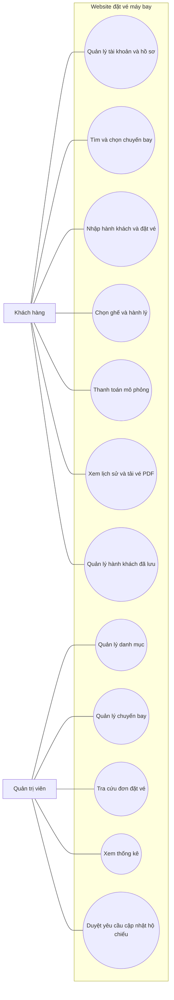
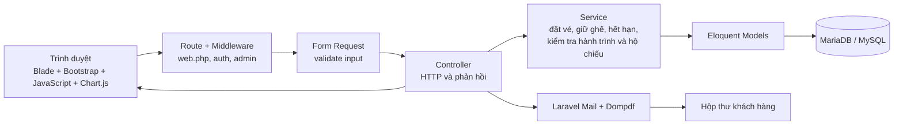
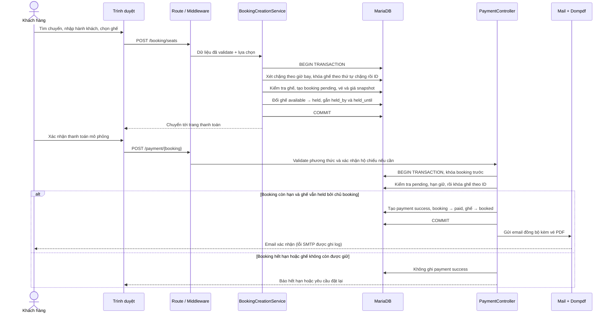
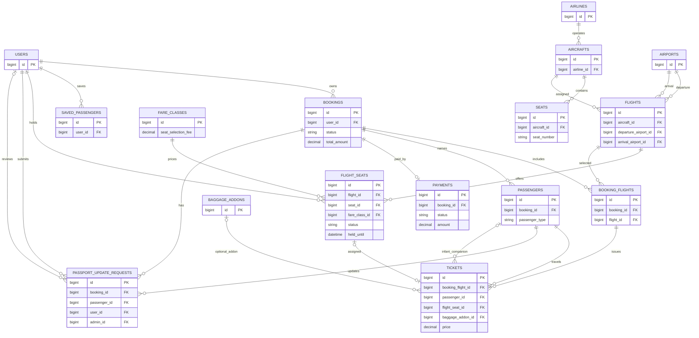

# Website đặt vé máy bay — sơ đồ và nội dung thuyết trình

Tài liệu này được đối chiếu với routes, migrations và nghiệp vụ trong source hiện tại. Ba sơ đồ Mermaid có thể xuất thành SVG/PNG từ Mermaid Live Editor để chèn vào slide. ERD dưới đây được dựng từ 15 bảng nghiệp vụ trong migrations; repo hiện không có `DB_IDEA_4.md`.

## Sơ đồ 1 — Use case

## Sơ đồ 2 — Kiến trúc tổng quan

## Sơ đồ 3 — Đặt vé và thanh toán

## ERD — 15 bảng nghiệp vụ

## Nội dung PowerPoint — 18 slide

Mỗi slide giữ tối đa bốn ý chính. Slide 4, 5, 6 và 8 ưu tiên sơ đồ tương ứng ở trên.

1. **Tiêu đề** — Website đặt vé máy bay; tên môn; nhóm 4 thành viên; giảng viên.
2. **Vấn đề và mục tiêu** — Đặt vé trực tuyến cần tránh giữ trùng ghế; hoàn tất hành trình từ tìm chuyến đến vé điện tử; vai trò khách hàng và quản trị viên.
3. **Công nghệ** — Laravel 12, Blade, Bootstrap, JavaScript/fetch; MariaDB/MySQL và Eloquent; Breeze, Form Request, Dompdf, Laravel Mail, Chart.js; monolith giúp nhóm triển khai và vận hành gọn.
4. **Use case** — Chèn sơ đồ 1; nhóm chức năng khách hàng và quản trị viên.
5. **Kiến trúc** — Chèn sơ đồ 2; request qua route/middleware, controller và service đến database.
6. **Thiết kế dữ liệu** — Chèn ERD; 15 bảng nghiệp vụ; ghế vật lý `seats` tách ghế từng chuyến `flight_seats`; `booking_flights` hỗ trợ nhiều chặng; giá vé lưu snapshot ở `tickets.price`.
7. **Hành trình người dùng** — Tìm chuyến, chọn chuyến từng chặng, nhập hành khách, chọn ghế, thanh toán, xem lịch sử và tải PDF; một chiều, khứ hồi, đa chặng.
8. **Sequence đặt vé và thanh toán** — Chèn sơ đồ 3; nhấn mạnh hai lần transaction: giữ ghế khi tạo booking và xác nhận ghế khi thanh toán.
9. **Giữ ghế và chống đặt trùng** — Hold 20 phút; lazy expiry; transaction và `lockForUpdate`; thiếu ghế ở một chặng thì rollback toàn booking; trạng thái ghế `available → held → booked`.
10. **Quy tắc giá** — Giá chỗ + phí chọn ghế tự chọn + hành lý; em bé 10% giá ghế gốc của người lớn đi kèm; hành lý tính theo từng chặng; tổng booking cộng mọi vé và chặng.
11. **Ghế, hành lý, hộ chiếu** — Ghế riêng theo chặng, tự gán nếu bỏ qua; mỗi khách tối đa một gói hành lý, em bé không mua; chuyến quốc tế yêu cầu thông tin hộ chiếu và xác nhận cảnh báo còn hạn dưới sáu tháng.
12. **Quản trị** — CRUD danh mục và chuyến bay; tìm kiếm, lọc, phân trang đơn; dashboard doanh thu theo tháng, chuyến theo hãng và tỷ lệ lấp đầy; duyệt yêu cầu cập nhật hộ chiếu.
13. **Bảo mật và phân quyền** — Middleware `auth`/`admin`; booking tải theo chủ sở hữu; kiểm tra dữ liệu đầu vào; soft delete danh mục giữ liên kết lịch sử.
14. **Kiểm thử** — Cập nhật số liệu sau khi chạy `php artisan test`, `vendor/bin/pint --test` và `npm run build`; nêu các luồng đã kiểm thử thủ công theo kết quả thực tế.
15. **Demo 5 phút** — Đăng nhập; tìm khứ hồi; nhập 2 người lớn + 1 em bé; chọn ghế; thanh toán; mở lịch sử và PDF; xem đơn và dashboard admin.
16. **Hạn chế** — Thanh toán mô phỏng; email gửi đồng bộ; phí chọn ghế theo hạng vé; một số kiểm tra nghiệp vụ còn inline trong controller.
17. **Hướng phát triển** — Cổng thanh toán sandbox; queue email; phí ghế theo vị trí; đa ngôn ngữ; đổi hoặc hủy vé.
18. **Phân công và Q&A** — Namv: lõi đặt vé, điều phối; Luân: admin, hành lý, sơ đồ ghế; Nguyên: hồ sơ hành khách, tiện ích; thành viên còn lại: giao diện.

## Câu hỏi thường gặp

- **Hai người cùng đặt một ghế?** Transaction khóa ghế bằng `lockForUpdate`; request sau kiểm tra trạng thái sau khi lấy được khóa. Ràng buộc duy nhất trên `tickets.flight_seat_id` là lớp bảo vệ bổ sung.
- **Ghế giữ mãi nếu khách rời trang?** Sau 20 phút, sơ đồ ghế xem hold đã hết hạn như ghế trống; booking bị hủy khi hết hạn được xử lý qua luồng tìm chuyến hoặc trang thanh toán.
- **Vì sao chưa dùng queue/scheduler?** Quy trình chạy được trong môi trường local mà không cần tiến trình nền; email hiện gửi đồng bộ.
- **Vì sao thanh toán mô phỏng?** Phạm vi hiện tại chưa tích hợp cổng thanh toán thực; muốn nhận callback cần endpoint có thể truy cập công khai.
